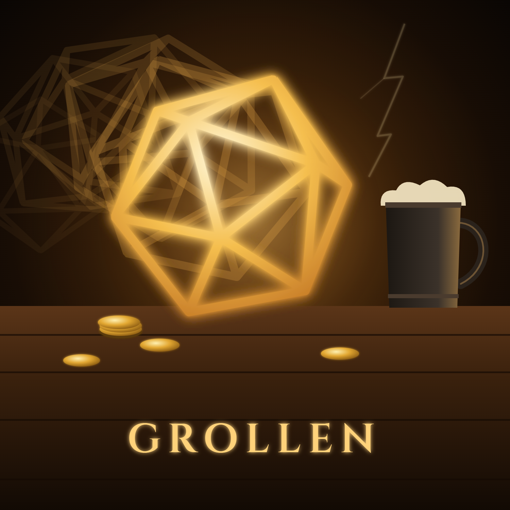

# Grollen -DnDGen.RollGen Theme-



The DnDGen.RollGen theme song: a tavern gambling and drinking song, where the dice roll like thunder across the table.
Its lyrics come from the [DnDGen.RollGen README](https://github.com/DnDGen/DnDGen.RollGen/blob/main/README.md), sung in plain English,
and its chorus brings back RollGen's leitmotif, *Grollen*, from the [DnDGen main theme](https://github.com/DnDGen/.github/blob/main/theme-song/README.md).

**Not on Suno yet.** The maintainer generates the song from this page; see Suno Notes.

## Updating

This song follows the [DnDGen.RollGen README](https://github.com/DnDGen/DnDGen.RollGen/blob/main/README.md).
Every pull request that changes the README gets a song check:

1. If the change rewords or removes a phrase in the Sources table below, the song needs updating.
   The tests catch this one: they fail and list every quoted phrase that is no longer in the README.
2. Otherwise, if the change alters the README's high-level ideas or vibe, the song needs updating.
3. Otherwise, it doesn't. Changes to the README's Theme Song badge or section never need a song update.

When the song needs updating, it happens in the same pull request:

1. The contributor updates the Lyrics and Sources here to match the new README.
   Names are sung as words, never as code.
2. The maintainer makes the new song in Suno:
   - **Cover the current song**, so the theme stays recognizably the same song as it evolves.
   - Use the Title, Style, and Lyrics from this page. **Leave the Style as it is**: only the lyrics change.
   - **Turn Variety all the way down**, so Suno keeps to the Style instead of straying from it.
   - Pick the take. The new take replaces the old one.
   - **Publish it**, so anyone with the link can find and hear it.
3. The maintainer updates the Suno link here and in the README, and adds anything learned to the Suno Notes.

## Title

```
Grollen -DnDGen.RollGen Theme-
```

## Style

```
Rowdy fantasy tavern drinking song, a stomping Celtic pub folk singalong in a swaying 6/8, Fiddle, tin whistle, accordion and bouzouki over a pounding bodhran and hand claps, Tankards thumping the table on every downbeat, with dice rattling in a cup and clattering across wood as percussion, A warm, raspy, grinning baritone lead, like an innkeeper telling tall tales, A boisterous crowd of gamblers roaring the choruses, with call-and-response shouts, cheers and laughter, A low rumble of distant thunder under the intro and every chorus, Verses quick and patter-like, choruses huge and swaying, A hushed bridge where the dealer calls out the rules and the crowd shouts them back, then a key change into a final chorus with everyone standing on the tables, Lively, warm, live-in-the-room production, Cheerful, a little drunk, and deadly serious about rolling dice
```

## Lyrics

```
[Intro - dice rattle in a cup and tumble across a wooden table, a low rumble of thunder, then the whole tavern stomps in]
(Grollen! Grollen!)
Roll the dice!
(Roll the dice!)

[Verse 1 - quick and patter-like, tankards on the downbeat]
Rolls a set of dice
As determined by the D20 die system
Simply use the verbose, fluid syntax
Four six-sided dice, and add them up
Chain the dice, evaluated left to right
Keep the highest three
And let the others go

[Pre-Chorus]
True if high, false if low
(High or low!)
Roll the percentile and you'll know
(Now you know!)

[Chorus - the whole tavern, call and response]
Grollen! Grollen!
(Roll the dice!)
Thunder on the table
(Roll the dice!)
Add them up and drink them down
Ten thousand dice in one roll!
Grollen! Grollen!
Roll again!

[Verse 2]
If a six is rolled
Then an additional roll is performed
Exploding dice could roll forever
(Forever!)
If a one is rolled
We will count it as a six
First explode, then transform, then keep
That's the order of operations

[Pre-Chorus]
True if high, false if low
(High or low!)
Roll the percentile and you'll know
(Now you know!)

[Chorus - the whole tavern, call and response]
Grollen! Grollen!
(Roll the dice!)
Thunder on the table
(Roll the dice!)
Add them up and drink them down
Ten thousand dice in one roll!
Grollen! Grollen!
Roll again!

[Verse 3 - faster, the gamblers lean in]
Give me a range and I'll give you a roll
Every whole number, and nothing outside it
With the fewest dice
Or the most evenly spread
Add a number, or another roll
Subtract it, multiply, divide
Take the remainder after dividing
A roll being built, and the calls all chain

[Bridge - hushed, the dealer calls and the crowd shouts back]
Is the roll valid?
Quantity is too low!
(Too low!)
Decimals are not allowed for dice operations!
(Not allowed!)
It explodes on all values!
(All values!)
This is not a roll!
(Not a roll!)
Ten thousand sides on one die
And the die is too high!

[Verse 4 - building back up]
This contains a roll for rolling stats
Fireball does damage, roll it out
Ghouls and zombies, strict or lenient
Was it bad, or was it good?
Somewhere between the lowest and the highest
Version seventeen needs .NET ten
Use sixteen if you're still on .NET eight

[Final Chorus - key change, everyone standing on the tables]
Grollen! Grollen!
(Roll the dice!)
Thunder on the table
(Roll the dice!)
Add them up and drink them down
Ten thousand dice in one roll!
Through Ninject, or from the factory
If you are not using Ninject
Grollen! Grollen!
Roll again!

[Outro - the band drops out, the crowd murmurs over one rattling cup]
The average
The lowest possible result
The highest possible result
(Grollen...)
[A last die tumbles and settles, and the thunder rolls away]
```

## Sources

| Lyric | From the README |
|---|---|
| Roll the dice! | Introduction: "Rolls a set of dice" |
| Rolls a set of dice<br>As determined by the D20 die system | Introduction: "Rolls a set of dice, as determined by the D20 die system." |
| Simply use the verbose, fluid syntax | Use: "To use RollGen, simply use the verbose, fluid syntax" |
| Four six-sided dice, and add them up | Use: "dice.Roll(4).d6().AsSum()" |
| Chain the dice, evaluated left to right | Use: "Evaluated left to right" |
| Keep the highest three<br>And let the others go | Use: "Returns the highest 3 rolls" and Reference: "Keeps only the highest rolls, this many of them." |
| True if high, false if low | Use: "Returns true if high (51-100), false if low (1-50)" |
| Roll the percentile and you'll know | Use: "dice.Roll().Percentile().AsTrueOrFalse()" |
| Grollen! Grollen! | Not from the README: RollGen's leitmotif from the DnDGen main theme, German for a rumble, or roll, of thunder |
| Thunder on the table | Not from the README: the leitmotif's thunder, rolling across the tavern table |
| Add them up and drink them down | Reference: "Rolls, and returns the total" |
| Ten thousand dice in one roll! | Reference: "10,000, the most dice in one roll" |
| Roll again! | Reference: "rolls it again, and counts both" |
| If a six is rolled<br>Then an additional roll is performed | Use: "If a 6 is rolled, then an additional roll is performed." |
| Exploding dice could roll forever | Reference: "Exploding dice could roll forever" |
| If a one is rolled<br>We will count it as a six | Use: "If a 1 is rolled, we will count it as a 6." |
| First explode, then transform, then keep<br>That's the order of operations | Order of Operations: "this is the order of operations:" and "1. Explode 2. Transform 3. Keep" |
| Give me a range and I'll give you a roll<br>Every whole number, and nothing outside it | Reference: "Builds roll expressions that produce every whole number in a range, and nothing outside it." |
| With the fewest dice | Reference: "The roll with the fewest dice" |
| Or the most evenly spread | Reference: "The roll whose results are most evenly spread" |
| Add a number, or another roll | Reference: "Adds an expression, a number, or another roll." |
| Subtract it, multiply, divide | Reference: "Subtracts an expression", "Multiplies by an expression", and "Divides by an expression" |
| Take the remainder after dividing | Reference: "Takes the remainder after dividing" |
| A roll being built, and the calls all chain | Reference: "A roll being built." and "so calls chain" |
| Is the roll valid? | Use: "Returns whether the roll is valid" |
| Quantity is too low! | Use: "because quantity is too low" |
| Decimals are not allowed for dice operations! | Use: "because decimals are not allowed for dice operations" |
| It explodes on all values! | Use: "because it explodes on all values" |
| This is not a roll! | Use: "this is not a roll" |
| Ten thousand sides on one die<br>And the die is too high! | Reference: "10,000, the most sides on one die" and Use: "because die is too high" |
| This contains a roll for rolling stats | Use: "This contains a roll of 4d6k3 for rolling stats" |
| Fireball does damage, roll it out | Use: "Fireball does" |
| Ghouls and zombies, strict or lenient | Notes: "ghouls and 2d4 zombies" |
| Was it bad, or was it good?<br>Somewhere between the lowest and the highest | Reference: "Describes `roll` by where it falls between the lowest and highest possible results" and "it chooses between `Bad` and `Good`" |
| Version seventeen needs .NET ten<br>Use sixteen if you're still on .NET eight | Installing: "Version 17 requires .NET 10. Use version 16.x if you are still on .NET 8." |
| Through Ninject, or from the factory<br>If you are not using Ninject | Getting `Dice` Objects: "Get an instance through Ninject" and "through `DiceFactory` if you are not using Ninject" |
| The average<br>The lowest possible result<br>The highest possible result | Reference: "The average result.", "The lowest possible result", and "The highest possible result" |

## Suno Notes

Nothing generated yet. For the first drafts (v0.1, v0.2, and so on), per the main theme's
[New Theme Songs](https://github.com/DnDGen/.github/blob/main/theme-song/README.md#new-theme-songs):

- Make a fresh generation from the Title, Style, and Lyrics above that Samples the main theme's
  "Rogante Marendor" snippet, 3:00.0 to 3:17.1, with Variety all the way down.
- The take that merges is v1. Every update after that Covers the current song instead.
- DnDGen.Stress's notes still apply: no code in the lyrics, and Suno pulls hard towards metal, so
  the Style leans on folk instruments and the crowd.

## Album Art

[cover.png](cover.png) is rendered from [cover.html](cover.html), which you can open in any browser.
To render it again at 1500 × 1500, from this folder:

```
msedge --headless --hide-scrollbars --allow-file-access-from-files --window-size=1500,1500 --screenshot=cover.png cover.html
```

If Edge reads `cover.html` as a web address, pass it as a full `file:///` URL instead.

- It is the main theme's [cover](https://github.com/DnDGen/.github/blob/main/theme-song/cover.html), recoloured for the tavern.
  The d20 tumbles across a tavern table among coins and a tankard, and the ghost copies behind it are its roll:
  the rumble of thunder that RollGen's leitmotif, *Grollen*, is named for.
- The d20 is the dndgen.com loading spinner, from [DnDGen.Web](https://github.com/DnDGen/DnDGen.Web/blob/main/dndgen-web/src/assets/loadingDice.svg), originally from [a gist by hperantunes](https://gist.github.com/hperantunes/f4c2fd407c2ea74c6c9d).
- The title is set in [Cinzel](https://github.com/NDISCOVER/Cinzel), included as [Cinzel.ttf](Cinzel.ttf) under the [SIL Open Font License](Cinzel-OFL.txt).
